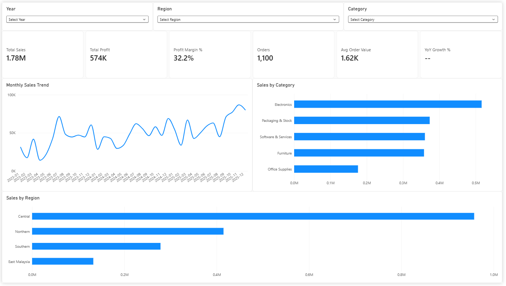

# Sales & Profit Performance Dashboard (Power BI)

A 3-page Power BI dashboard analysing sales, profit margin, and discounting across product categories, regions, and sales channels.

> **Note:** This project uses a **simulated dataset** built for portfolio practice. It is not real company data.

## Business Questions
1. How are sales and profit trending year over year?
2. Which product categories drive profit, and which dilute it?
3. Where do discounts reduce margin the most?

## Dataset
- 1,786 order lines (1,100 orders), Jan 2023 to Dec 2025, in MYR
- Tables: Sales (fact), Products, Customers, plus a Date table
- Star schema: Sales linked to Products, Customers, and Date

## Dashboard Pages

### 1. Overview
KPIs, monthly sales trend, sales by category and region, with year / region / category slicers.

### 2. Product & Profit
Top 10 products, profit margin and discount rate by category, sales by channel.

### 3. Insights & Recommendations
Three findings, each backed by a chart, with a recommended action.

## Key Findings
- Furniture is 20% of sales but 6% of profit (margin 9.8% after discounts, 16.1% before)
- Software & Services earns 34% of profit from 20% of sales
- Distributor orders carry an 8.9% average discount versus about 3.7% for Online and Direct, and a lower margin (27.6% vs about 33%)

## Methods
- **Power Query:** data type cleanup, header promotion
- **DAX measures:** Total Sales, Total Profit, Profit Margin %, Orders, Avg Order Value, YoY Growth %, Gross Sales, Discount Rate %, Margin Before Discount %, Sales Share %, Profit Share %
- **Data modelling:** star schema with a marked Date table

## Files
- `Sales_Performance_Dashboard.pbix`: Power BI file (open with Power BI Desktop, Windows)
- `PowerBI_Sales_Dataset.xlsx`: source data (simulated)
- `Overview.png`, `Product & Profit.png`, `Insights & Recommendations.png`: dashboard screenshots

## Limitations
Findings describe the simulated data only. Discount effects are associations, not proven causes.

## Author
Loh Chun Khee | [LinkedIn](https://www.linkedin.com/in/chun-khee-loh-0242a43b4)
